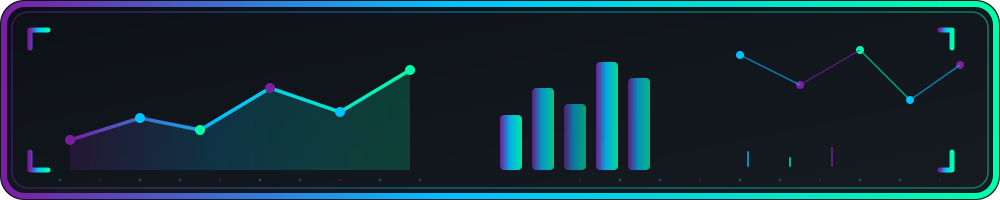

  

<h1 align="center">Hi, saya al-DataEngineer 👋</h1>

  <b>Mahasiswa Sains Data • Semester 3 • Masih belajar, dan bangga dengan itu 🚀</b>

  

  
  
  

## 🧑‍💻 Tentang Saya

Halo! Saya mahasiswa **Sains Data** semester 3 yang sedang menapaki jalur **data engineering**. Masih di awal perjalanan, tapi semangat belajar besar. Saya suka banget:

- 🔍 Mengeksplorasi dataset dan bongkar-bongkar data
- 🐍 Ngoprek **Python** untuk analisis data
- 🗄️ Belajar merancang **database & SQL**
- 📊 Memahami alur data dari hulu ke hilir

> 💬 *"Setiap ahli pernah jadi pemula. Aku cuma sedang berproses."*

## 🔥 Saat Ini Saya Sedang Belajar

- 📚 **Python** (pandas & numpy) untuk manipulasi dan pembersihan data
- 🗃️ **SQL** dan konsep database
- 🧹 **Data cleaning / data wrangling** dengan dataset publik
- 🌱 Dasar **Git & GitHub** untuk kebiasaan kolaborasi
- 🎯 Mempersiapkan fondasi menuju data engineer

## 🛠️ Skill yang Sedang Dipelajari

### Bahasa Pemrograman

### Tools & Teknologi

> ⚠️ Status: masih tahap **belajar** — belum berani klaim pro 😄

## 📊 GitHub Stats

  
  

  

  

## 🛠️ Proyek yang Lagi Saya Garap

*(sedang diisi — hasil belajar dan eksperimen datanya bakal muncul di sini)*

| Nama Proyek | Deskripsi | Status |
|:---|:---|:---:|
| `belajar-data-cleaning` | Praktik pembersihan dataset publik pakai pandas | 🚧 In Progress |
| `sql-basics` | Catatan & latihan SQL dari dasar | 🚧 In Progress |
| *(masih kosong)* | Siap diisi dengan proyek pertamamu! | ⏳ Segera |

> 🔗 Lihat repo lain yang lagi saya kerjakan di [sini](https://github.com/al-DataEngineer?tab=repositories).

## 📫 Hubungi Saya

  
  
  
  

> ✏️ Gmail sudah terisi `ahmadalimin700@gmail.com` — tinggal ganti link Instagram, LinkedIn, dan X dengan akunmu.

  <b>Terima kasih sudah mampir! Jangan sungkan untuk nyapa atau ngajak belajar bareng. 🙌</b>

  

---

*Dibuat dengan 🐍 + ☕ sebagai mahasiswa yang sedang belajar. README ini akan terus berkembang seiring perjalanan belajarku.*
